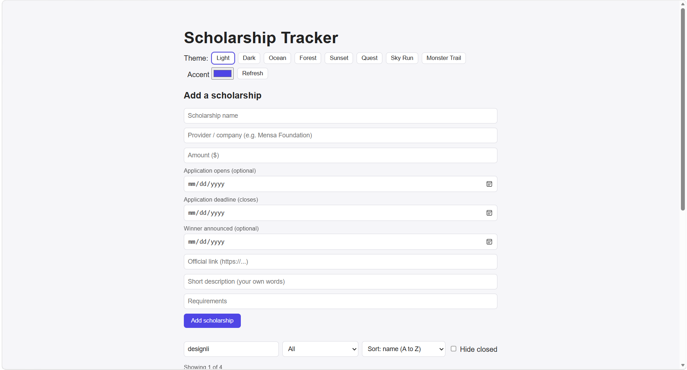
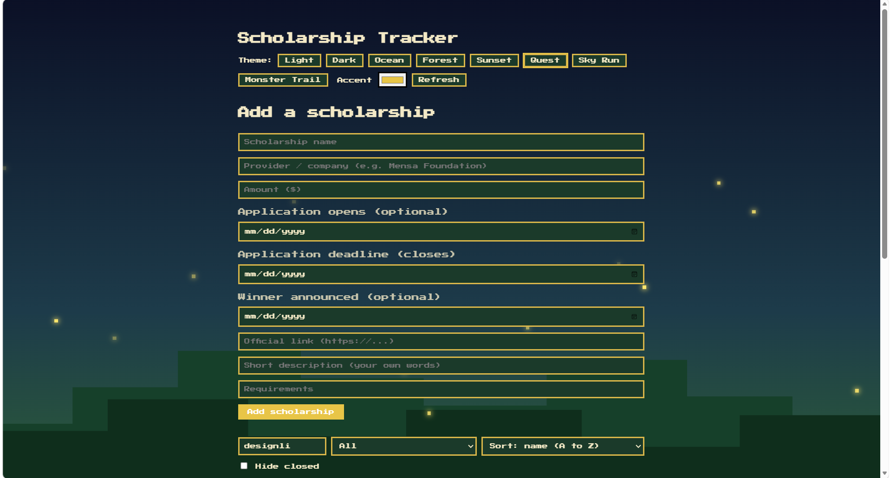
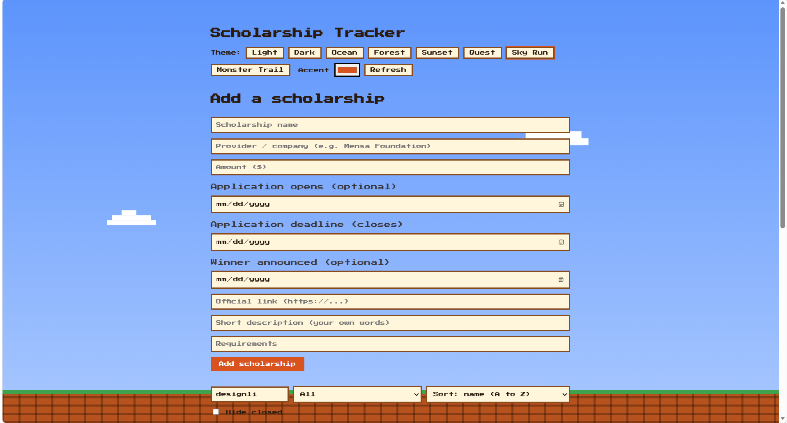
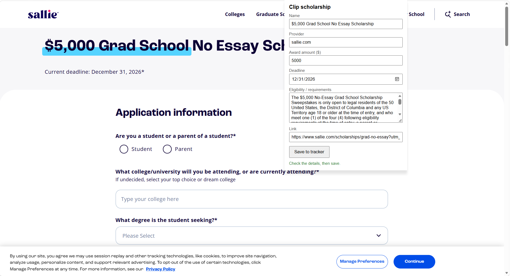

# Scholarship-Tracker

Full-stack scholarship management application built with React, Python (Flask), and SQLite. It tracks scholarship deadlines, requirements, application statuses, and submission dates in one place, and includes a browser extension that clips scholarship details straight from a web page.

## Screenshots






## Features

- Add, edit, and delete scholarships (name, provider, amount, link, description, requirements)
- Application window with open date, deadline, and winner announcement date, plus a live status badge (Opens in X days, Closes in X days, Closed)
- Track application status (Not Started, In Progress, Applied, Submitted) with an automatic submission date
- Search, filter by status or closing soon, sort by deadline, amount, name, or newest, and hide closed scholarships
- Eight themes, including animated 8-bit scenes, plus a custom accent color
- Browser extension that pulls the name, amount, deadline, and eligibility from the page you are viewing
- Auto-refreshing list and an offline warning when the backend is not running
- Terminal version of the app (`main.py`)

## Tech Stack

- **Frontend:** React (Vite), CSS animations
- **Backend:** Python, Flask, Flask-CORS
- **Database:** SQLite
- **Extension:** JavaScript (Manifest V3)
- **Tools:** Git, GitHub

## How to Run

**1. Backend**

```
pip install flask flask-cors
python app.py
```

The API runs at http://127.0.0.1:5000. The SQLite database is created automatically on first run.

**2. Frontend** (in a second terminal)

```
cd frontend
npm install
npm run dev
```

Open http://localhost:5173 in your browser.

**3. Browser extension (optional)**

1. Open `edge://extensions` (or `chrome://extensions`) and turn on Developer mode.
2. Click **Load unpacked** and choose the `extension` folder.
3. Pin **Scholarship Clipper**, open a scholarship page with the backend running, and click the icon.
4. Review the auto-filled fields and click **Save to tracker**.

The clipper guesses fields from the page text, so always check the amount and deadline against the official page before saving.

## Terminal Version

```
python main.py
```

## API

| Method | Route | Purpose |
|---|---|---|
| GET | `/api/scholarships` | List all scholarships |
| POST | `/api/scholarships` | Add a scholarship |
| PUT | `/api/scholarships/<id>` | Edit a scholarship |
| PUT | `/api/scholarships/<id>/status` | Change application status |
| DELETE | `/api/scholarships/<id>` | Delete a scholarship |